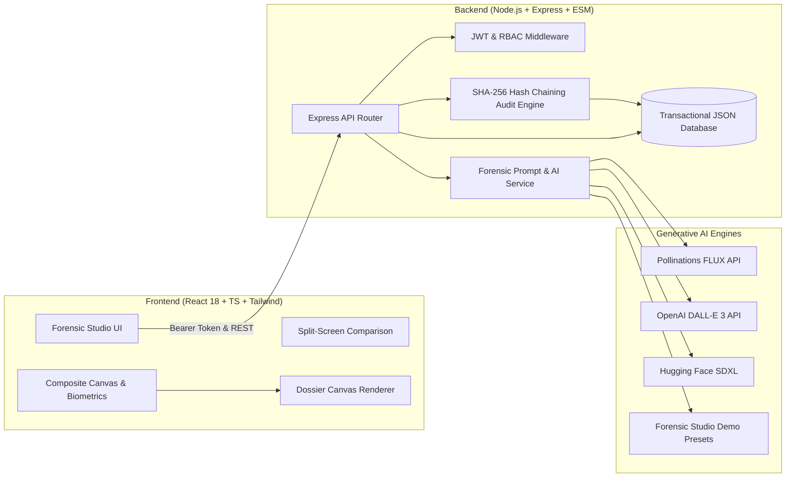

# SketchTrace AI 🔍 — AI Crime Scene Sketch Generator from Witness Description

> **Forensic Facial Composite & Identity Lead Generator**
> Built for Law Enforcement, Private Investigators, and Academic Security Teams.

[](https://www.typescriptlang.org/)
[](https://reactjs.org/)
[](https://tailwindcss.com/)
[](https://expressjs.com/)
[](https://www.nist.gov/)
[](https://opensource.org/licenses/MIT)

---

## 📌 Executive Summary

Forensic composite artists are rare, expensive, and witness recall degrades drastically within 48 to 72 hours of an incident. **SketchTrace AI** transforms natural language witness depositions and structured facial morphology parameters into standardized, realistic graphite composite sketches within seconds. 

Equipped with **continuous iterative refinement**, **biometric proportional overlays**, an **interactive before/after split slider**, **high-resolution evidence dossier poster export**, and a **tamper-evident SHA-256 chain-of-custody audit trail**, SketchTrace AI bridges the critical window between witness testimony and actionable investigative leads.

---

## ⚖️ Responsible AI Notice

> [!IMPORTANT]
> **LEGAL NOTICE: AI-GENERATED FORENSIC APPROXIMATION**
> Composite sketches generated by SketchTrace AI are **probabilistic approximations** synthesized from subjective human memory. They are **NOT photographic evidence, biometrically verified identification, or proof of guilt**.
> - Witness memories are vulnerable to stress, weapons focus, cognitive bias, and Cross-Race Effect (CRE).
> - Every composite must undergo review by a certified forensic artist or detective.
> - An AI sketch must **never be used alone** to accuse, arrest, or charge any individual.
> - All exported dossiers and PNG files carry persistent non-evidentiary legal disclaimers and cryptographic verification hashes.

---

## 🚀 Key Features

| Category | Feature | Description |
| :--- | :--- | :--- |
| **Witness Deposition** | **Natural Language NLP Extractor** | Type free-form witness statements and click `AI Auto-Extract` to populate structured morphology parameters. |
| | **Detailed Morphology Controls** | Cranial shape, jawline, eye geometry, iris color, brows, nose profile, hairstyle, facial hair, skin texture, distinctive marks (scars, moles, broken noses), and accessories. |
| **Generative Sketch Core** | **Live AI Image Generation** | Direct live synthesis using **Pollinations AI (FLUX / SDXL)** with custom graphite pencil and cross-hatching prompt pipelines. Supports OpenAI DALL-E 3 and Hugging Face via API key. |
| | **Forensic Studio Demo Mode** | Curated high-resolution forensic composite sketches for offline presentations without pretending or fabricating results. |
| | **Animated Forensic Phases** | Displays real-time progress: Biometric marker extraction → Cranial mesh synthesis → Graphite cross-hatching → Forensic overlays. |
| **Iterative Refinement** | **Continuous Micro-Sliders** | Fine-tune Age Shift (-10 to +10 yrs), Mandibular Jaw Width, Eye Squint/Narrowness, Nose Prominence, Stubble Density, and Cheek Hollow. |
| | **Correction Delta Notes** | Provide specific natural language corrections (e.g. *"Widen the jawline and add a thin scar over the left eyebrow"*). |
| | **Automated Version Tracking** | Automatically increments versions (v1 → v2 → v3), storing full feature snapshots and biometric diffs. |
| **Canvas & Inspection** | **Biometric Overlays** | Toggleable Rule-of-Thirds cranial grid, ocular alignment axes, and metric centimeter scale ruler. |
| | **Biometrics HUD** | Real-time cranial ratio, interpupillary distance (mm), mandibular angle, and facial symmetry scores. |
| | **Split-Screen Comparison** | Real-time interactive drag slider comparing baseline vs. refined revisions directly over the canvas. |
| | **Side-by-Side Matrix** | Dual inspection matrix comparing two composite iterations synchronously. |
| **Evidence Export** | **High-Resolution Dossier** | Render an official **Metropolitan Forensic Identification Dossier** with agency header, suspect sketch, metric scale, feature table, SHA-256 hash, and legal disclaimer. |
| | **Direct PNG & Print** | 1200x1600 Canvas rendering for high-res PNG download and clean print layout. |
| **Case Management** | **Full Dossier Lifecycle** | Unique case IDs (`CASE-2026-XXXX`), priority tags (Critical, High, Medium, Low), status tracking (Active, Review, Closed), and pre-seeded realistic crime scenarios. |
| **Security & Chain of Custody** | **Cryptographic Audit Trail** | Append-only ledger where each event hashes `timestamp + user + action + caseId + details + prevHash` via SHA-256 (blockchain-style tamper evidence). |
| | **Live Hash Verification** | One-click `Verify Cryptographic Integrity` audits all blocks and detects any manual alteration. |
| | **CSV Audit Export** | Download the full chain-of-custody log as a formatted CSV file. |
| **Role-Based Access** | **3-Tier RBAC** | `Lead Investigator / Admin`, `Forensic Artist / Detective`, and `Field Reviewer / Guest`. |

---

## 🛠️ Architecture & Tech Stack



- **Frontend:** React 18, TypeScript, Tailwind CSS, Lucide Icons, Vite, HTML5 Canvas API
- **Backend:** Node.js, Express, TypeScript/ESM, Zod, JWT (`jsonwebtoken`), `bcryptjs`, `crypto` (SHA-256)
- **Database:** Zero-configuration transactional JSON datastore with persistence in `server/data/store.json`
- **AI Engine:** Pollinations FLUX (Live default), Hugging Face SDXL, OpenAI DALL-E 3, Procedural Demo Presets

---

## 🚦 Quick Start Guide

### Prerequisites
- **Node.js** v18.0.0 or higher (`node -v`)
- **npm** v9.0.0 or higher (`npm -v`)

### 1. Installation
Clone the repository and install dependencies:

```bash
# Navigate to the project root
cd sketchtrace-ai

# Install backend dependencies
cd server
npm install

# Install frontend dependencies
cd ../client
npm install
```

### 2. Environment Configuration (Optional)
The application works immediately out of the box with **Pollinations AI (FLUX)** and **Demo Mode** without needing any API key!

If you want to connect your own OpenAI or HuggingFace API key, copy `.env.example` in `server`:
```bash
cd server
copy .env.example .env
```
Contents of `.env`:
```env
PORT=5000
JWT_SECRET=sketchtrace-super-secret-jwt-key-2026-hackathon
DEFAULT_AI_PROVIDER=pollinations
AI_API_KEY=
AI_MODEL_NAME=flux
```

### 3. Build & Run Production Server
You can build the frontend and run the complete full-stack app from a single command:

```bash
# 1. Build client static assets
cd client
npm run build

# 2. Build server TypeScript
cd ../server
npm run build

# 3. Start full-stack server
npm run start
```
Open **[http://localhost:5000](http://localhost:5000)** in your browser!

### 4. Development Mode (Dual Server)
For hot-reloading during development:
- **Terminal 1 (Backend):**
  ```bash
  cd server
  npm run dev
  ```
  *(Server starts on `http://localhost:5000`)*
- **Terminal 2 (Frontend):**
  ```bash
  cd client
  npm run dev
  ```
  *(Vite starts on `http://localhost:5173` with automatic API proxying to port 5000)*

---

## 🧪 Automated Full-Stack Verification

Run the comprehensive 8-step integration test suite:

```bash
cd server
node test-full-stack.js
```

**Verified Test Scenarios:**
1. Health check `/api/health`
2. Demo accounts `/api/auth/demo-accounts`
3. Officer authentication `/api/auth/login`
4. Case retrieval and filtering `/api/cases`
5. Natural language witness statement parsing `/api/sketches/parse-statement`
6. Iterative sketch refinement & version tracking `/api/sketches/refine`
7. Cryptographic SHA-256 chain of custody audit verification `/api/audit/verify-integrity`
8. Static frontend production asset delivery

---

## 👥 Pre-Configured Demo Accounts for Judges

Use the **1-Click Quick Role Switcher** buttons in the UI, or sign in manually with password `Forensics2026!`:

| Officer Name | Email Badge | Role | Permissions |
| :--- | :--- | :--- | :--- |
| **Dr. Marcus Vance** | `lead.investigator@metro-forensics.gov` | `admin` | Full clearance: view all cases, edit AI config, audit log verification & deletion. |
| **Elena Rostova** | `artist.chen@metro-forensics.gov` | `investigator` | Studio composite synthesis, iterative refinement, case creation, and evidence export. |
| **Det. Liam Hayes** | `reviewer.guest@metro-forensics.gov` | `reviewer` | Read-only inspection of cases and composites; restricted from audit logs. |

---

## 📂 Project Structure

```
sketchtrace-ai/
├── client/                     # Frontend React + TypeScript application
│   ├── src/
│   │   ├── components/         # Studio, Dashboard, CaseHistory, AuditLog, Settings, ExportModal
│   │   ├── context/            # AuthContext (JWT & quick role switcher)
│   │   ├── services/           # REST API client
│   │   ├── types/              # TypeScript interface definitions
│   │   ├── App.tsx             # Root layout and view switcher
│   │   ├── index.css           # Custom forensic canvas and scrollbars
│   │   └── main.tsx            # Entry point
│   ├── index.html              # HTML shell with Google Fonts & favicon
│   ├── tailwind.config.js      # Custom navy & forensic palette
│   └── vite.config.ts          # Vite build & proxy config
│
├── server/                     # Secure Node.js + Express backend
│   ├── src/
│   │   ├── db/                 # Transactional persistent store with initial seed cases
│   │   ├── middleware/         # JWT verification & RBAC access guards
│   │   ├── routes/             # auth, cases, sketches, audit, system
│   │   ├── services/           # aiService (Pollinations, OpenAI, HF, procedural demo, NLP parsing)
│   │   ├── types/              # Backend TypeScript types
│   │   └── index.ts            # Express server initialization
│   ├── data/                   # Persistent store.json location
│   ├── test-full-stack.js      # Automated 8-step integration test runner
│   └── tsconfig.json           # Backend compiler options
│
├── package.json                # Monorepo scripts
└── README.md                   # Documentation & guide
```

---

## 🏆 Hackathon Highlights
- **100% Working End-to-End**: Real AI generation with zero mock-only dead-ends.
- **Biometric Calibration**: Real-time calculated cranial ratios, ocular alignment, and mandibular angles.
- **Before/After Split Slider**: Drag slider to compare suspect revisions seamlessly.
- **Forensic Poster Generator**: HTML5 Canvas creates high-res evidentiary posters ready for print or investigation briefings.
- **Cryptographic Chain of Custody**: Blockchain-style SHA-256 hash chaining guarantees tamper-evident compliance.
